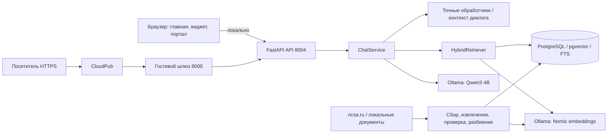

# Текущая архитектура MangoFlow AI

## Дополнение 17.11.2026 — глубокий обход, проверенный эксперимент

Актуальное продолжение находится в `D:\Codex-RAG-runtime\deep-knowledge-20261117\app`, ветка `codex/deep-knowledge-20261117`, код `a0fa11d`. Стабильный checkout `D:\Codex-RAG-runtime\academy-site-pilot-20261115-184534\app` проверен на HEAD `c94edf0`; он и облако не обновлялись. Папка `C:\Users\islam\Documents\ChatGPT\mangoflow ai` остаётся передачей, исходники в неё не переносились. Рабочий виджет расположен в корневом `widget/` checkout.

Полный отчёт: [DEEP_KNOWLEDGE_REPORT.md](docs/DEEP-KNOWLEDGE-20261117.md). В checkout: `docs/DEEP-KNOWLEDGE-20261117.md`. Он различает исторические результаты, нынешние проверки и ограничения.

Сегодня реально запущены отдельные PostgreSQL на 55433 и Ollama на 11534, crawler/Edge/OCR/индексация, сравнения и HTTP-проверки. Общие сервисы, основная БД, туннели и профиль не переключены. Исходная экспериментальная БД — дамп 15.11 без личных бесед, а не текущая БД владельца. Секретные конфигурации не публиковать.

Основной манифест: 3344 URL; 37 сохранённых ответов по файловым ссылкам (включая невалидные форматы); 108 индексированных управляемых ресурсов / 19027 chunks; 84 ресурса допущены, 24 в карантине; 1 точный дубликат; 0 подтверждённых 404/410 обычных ресурсов; 3226 в очереди. Это бюджетный снимок, не весь сайт. Вся кандидатная БД: 152 документа / 20083 chunks; допустимая часть указана в отчёте отдельно.

Проверки сейчас: **278 passed, 1 skipped, 1 прежний failed**, `test_focus_keeps_scholarship_source_and_removes_unrelated`. Прошли 67 новых проверок и 2 Node-файла; HTTP smoke — 14 проверок, строгие цитаты по HTTP — 2; синтетические проверки модели — 3/3; исторические 60 сценариев — 58/60 (№39 и №40 не прошли). Фразовые 60 регрессий не являются общей точностью. Полные новые сравнения, размеры наборов, достоверность и раздельные задержки приведены в отчёте.

Новые crawler/semantic chunks/multi-query/BM25/fuzzy/mMARCO и `ANSWER_MODE=source_quotes` сохранены как локальный opt-in. Строгий режим выбирает номера допущенных фрагментов и копирует их текст без свободного ответа модели; при ошибке выбора не возвращается к генерации и не снимает карантин документов. Defaults: прежний `profile`/`generative`, Qwen3 4B, Nomic 768, active `legacy-v1`; новый crawler и автоматическая синхронизация выключены. Не активировать по количеству материалов или одному просмотренному набору. После просмотра контроль становится регрессией. Далее сохранена предшествующая документация; старые высказывания о непроведённых проверках относятся к ней.

Новый поток: CrawlConfig/robots → ограниченный fetch/renderer → raw/fulltext/blocks и manifest → document_policy → semantic chunks → обе профильные embeddings → существующие PostgreSQL documents/chunks. Не создавалась вторая прикладная база вместо существующей схемы. Другую организацию/KB импортировать только в отдельную БД; это не ACL/RLS. В retrieval исходный запрос и гипотезы → корпусный BM25/FTS/vector → RRF → необязательный существующий reranker → фактический контекст модели. Один AsyncSession используется последовательно. Контент источников остаётся недоверенными данными.

<!-- END DEEP KNOWLEDGE UPDATE -->
Сверено 17.11.2026 с исходниками; без новых миграций и переиндексации.

## Компоненты и границы

Это модульный Python-монолит, отдельный процесс Ollama и отдельный PostgreSQL.
Облачный Docker deployment — другой экземпляр этой архитектуры, не upstream
последнего локального эксперимента. Полный API доверенный локальный; публичное
обслуживание идёт только через whitelist гостевого шлюза.

## Карта исходников

| Каталог/модуль | Ответственность |
|---|---|
| `src/core/main.py`, `config.py` | приложение, static mount, lifespan, настройки |
| `src/core/api/routes/` | chat, portal, health, files, admin |
| `src/core/services/chat_service.py` | маршрутизация, RAG, сохранение ответов, поток |
| `services/academy_scope.py`, `dialogue_context.py`, `history.py` | принадлежность подразделений и контекст беседы |
| `services/conversation_assistance.py` | социальные реплики, письмо/перевод/план, проверка перефразирования |
| `services/directory.py`, `management.py`, `specialties.py`, `hostel_facts.py`, `timetable.py` | предметные обработчики |
| `services/missing_information.py`, `request_scope.py` | границы запроса, отсутствие подтверждения и уточнения |
| `src/core/rag/` | поиск, индексы, происхождение контекста, разбор и индексация |
| `src/core/llm/` | интерфейс LLM и клиенты Ollama/OpenAI-compatible |
| `src/core/db/`, `migrations/` | схема, сессии, миграции |
| `src/core/share.py` | ограниченный гостевой шлюз |
| `widget/` | frontend без сборки; `demo`, `chat`, `embed`, `index`, renderer/http |
| `scripts/`, `tests/eval/`, `docs/` | административные/оценочные команды, эталоны, отчёты |
| `deploy/cpu-trial/` | Docker-конфигурация облачной пробы |

## Схема PostgreSQL

Источник: `db/models.py`, `rag/profiles.py` и три миграции. Метаданные предметной
области в JSONB: отдельных таблиц «преподаватели», «специальности», «кафедры»
в текущей ORM-схеме нет. Представления портала собираются из документов.

| Таблица | Основные поля и связи |
|---|---|
| `documents` | bigint id; external_id; title; source_url; source_type; JSONB meta; status; SHA256 content_hash; file_path/mime/size/name; created_at/updated_at. Unique `(source_type, external_id)`, GIN meta. Статусы ORM pending/indexed/failed/archived, PostgreSQL enum использует имена SAEnum. |
| `chunks` | bigint id, FK document_id с CASCADE; chunk_index; content; embedding и embedding_candidate; generated content_tsv; JSONB meta; token_count; created_at. Unique `(document_id, chunk_index)`. |
| `conversations` | bigint id; уникальный UUID session_id; channel; user_ref; JSONB meta; is_active; timestamps. meta содержит pending_clarification. |
| `messages` | bigint id; FK conversation_id с CASCADE; enum role; content; JSONB sources; JSONB usage; created_at. Источники хранят chunk/document IDs, title/url/score/snippet; usage — метрики, route, внутренний контекст и другие служебные сведения. |
| `retrieval_index_state` | одна строка id=1; JSONB active_profile и nullable candidate_profile. Модель, digest при наличии, dimension, префиксы, normalize/version/policy, пороги. |
| `alembic_version` | служебная ревизия миграций |

Оба векторных столбца в текущей установке — 768 измерений. HNSW cosine для
каждого, m=16/ef_construction=64. `content_tsv` вычисляется через русский
to_tsvector и индексируется GIN. Смена `EMBEDDING_DIM` в config не меняет схему.
Миграции: `72f6427c77d9` → `58bfa7cb42d8` → `a801searchprofiles`.

В meta используются происхождение/parent URL, дата проверки, способ извлечения,
page/pages/section/sheet, версия обработки, unit_key/unit_name/department_name,
поля карточек руководства/контактов, тестовость, review_required,
scholarship_material, review scope/text_verified/currency/период. Наличие
конкретного поля зависит от импортёра: JSONB не даёт всем материалам одну
жёсткую схему. Фактические примеры сверять с кодом импортёра, не предполагать.

## Маршрут ответа

1. Найти/создать беседу по UUID; границы приватных/неподтверждённых запросов.
2. Обработать социальную реплику, отмену, упрощение либо отдельную writing-задачу.
   Уточнить недостающий текст/цель/предмет; обычный новый вопрос меняет тему.
3. Разрешить pending unit-уточнение, определить подразделение из пользователя
   и релевантной истории. Годы, специальности, группы сохраняются. Не выводить
   новый факт из прошлого ответа ассистента.
4. Попробовать точные ответы из проверенных полей документов/intent/расписаний.
   Для другого института не проваливаться в колледжный обработчик директора.
5. В RAG сформировать contextual_query, учесть подразделение и группу;
   HybridRetriever возвращает hits/status/diagnostics.
6. `prepare_source_hits` и `restore_reviewed_sections` восстанавливают нужный
   контекст проверенного раздела, `context_hits` ограничивает реальный prompt.
   Окончательные sources должны ссылаться именно на переданные фрагменты.
7. Построить инструкции, получить Qwen-ответ или точную выдержку/навигацию,
   обработать нехватку подтверждения и предупреждение о периоде. Сохранить
   сообщения/источники/usage. Дополнительная answer review существует в коде,
   но в последней локальной конфигурации отключена.

Резолюция пользовательского контекста хранится в usage с
`resolution=dialogue_context_v1`, `resolved_question`; Message.content остаётся
исходным. `dialogue_neutral=true` исключает социальные реплики из рабочего
окна истории **до ограничения limit**. В portal история остаётся видимой.
Контекст ограничен последними репликами, это не неограниченная память диалога.

## Поиск: фактически выбранная ветка и альтернативы

`HybridRetriever` — диспетчер, не единый всегда одинаковый алгоритм:

- При `ACADEMY_RERANK_ENABLED=true` возможен academy_search/BGE; при сбое
  reranker предусмотрен fallback legacy с диагностикой. Сейчас false.
- При `RETRIEVAL_POLICY=evidence` без unit scope — EvidenceSearch: морфология,
  поиск по каталогу/разделам и дополнительные сигналы. Сейчас policy=profile.
- При policy профиля legacy **или наличии unit_keys** — LegacyRetriever.
  Для текущей установки это основной путь.
- Прочая semantic-ветка использует профиль, разные префиксы Nomic и mMARCO.
  Наличие кода не означает, что кандидат выбран в базе.

В legacy: синонимы → Nomic embedding → vector top20 + FTS top20 + при
необходимости focus FTS → RRF(k60) → мягкие добавки за слова/идентификаторы,
отбор и dedup → до четырёх фрагментов. Общий допуск по словесному coverage
ещё есть; отсутствие focus-слова больше не самостоятельный жёсткий фильтр.
Для однозначно названной кафедры навигация сначала ограничивает документы,
убирает название кафедры из лексического поиска факта. Сравнение подразделений
не должно ошибочно ограничиваться одной кафедрой.

FTS использует русский websearch_to_tsquery с OR по терминам и ts_rank_cd по
тексту/заголовку. Нельзя выполнять две операции одновременно на одном
AsyncSession: нынешний последовательный вызов vector/FTS намеренный.

Статусы RetrievalResult: matched/no_match/unavailable. В usage —
retrieval_status/search_ms/search_stages_ms/reranker_status. Ошибки не должны
маскироваться под «в базе нет данных». Скорость поиска ≠ скорость LLM.

## Индексация и жизненный цикл материала

- Общий `ingest_text`: идентификация `(source_type, external_id)`, SHA256,
  профиль обработки, разбиение, embeddings обоих существующих профилей,
  обновление чанков. Embeddings вычисляются до удаления прежних чанков,
  чтобы сбой не уничтожил рабочий индекс.
- Пропуск неизменившегося текста учитывает fingerprint профиля и разбиение.
  `_embedding_profiles`, `_chunking_profile` сохраняются в meta. Смена текста,
  извлечения/токенизатора/разбиения/префиксов может требовать нового индекса.
- `profiles.prepare` применяет нормализацию и query/document prefixes по
  профилю. Legacy хранит пустые префиксы; кандидат — `search_query: ` и
  `search_document: `. Нельзя смешивать их в одном векторном пространстве.
- Обход ncsa ограничен allowlist путей/домена и бюджетом страниц/PDF,
  проверяет редиректы; страницы извлекаются из HTML, PDF — текст/OCR.
  Лимиты включают 20 МБ, 150 страниц PDF, 150000 символов HTML; превышения
  фиксируются, а не означают успешную полную загрузку.
- Обычный разбор текста — рекурсивные фрагменты 800/120. Тематическое
  структурное разбиение сохраняет заголовки, абзацы, строки таблиц с колонками,
  page/sheet/section и ограничивается токенизатором Nomic (384 токена по
  умолчанию). Не переразбивать весь корпус без отдельной проверки.
- DOCX/XLSX поддержаны, DOC/XLS требуют конвертации. Формулы без кэша значения
  не дают основания угадывать число. OCR в таблицах требует ручной сверки.
- Стипендиальный сборщик читает grants и до 10 прямых тематических вложений.
  SHA256 связывает review с точным файлом. Дата скачивания отделена от срока
  действия. Допуск проверенных блоков не означает проверку всего документа.
- Общая политика исключает тестовые записи; для review_required или
  scholarship_material требуются `review.scope=spo_confirmed` и
  `review.text_verified=true`. Это предметное правило, не универсальная
  гарантия применимости академического документа к любому институту.
- Подтверждённые 404/410 архивируются, удалённые ссылки PDF учитываются только
  по успешно проверенному родителю. Необойдённый URL не считается обновлённым.
  Автообновление поддержано lifespan-задачей, но сейчас выключено.

`scripts.search_index` управляет candidate/status/build/swap. Старые векторы
сохраняются отдельно, swap транзакционный и обратимый. Для активации требуются
проверенный отчёт, полный профиль и совпадающий отпечаток корпуса. Текущий
неудачный кандидат не активировать; условия в `docs/SEARCH-V2.md`.

## API и frontend

Основные маршруты: `/health`, `/ready`, `/api/v1/chat`, `/api/v1/chat/stream`,
`/api/v1/portal/{overview,sources,source-status,teachers,schedule}`,
`/api/v1/portal/conversations/{session_id}`, feedback,
`/api/v1/files/{document_id}`. Админ ingest/sync/search/debug защищены
`X-Admin-Key`. UUID беседы сам по себе не является полноценной публичной
авторизацией полного локального API.

Поток — application/x-ndjson, события status/delta/done/error. Writing-задачи
и точные ответы могут дать только status→done; это штатно. Ссылки оформляются
после завершения/остановки, HTML не выполняется. Неполный остановленный ответ
не сохраняется как готовый ответ серверной истории.

Share выделяет private upstream UUID каждому guest cookie, проверяет origin,
размер тела, ограничения запросов и число одновременных ответов (два).
Сессии/лимиты в памяти одного процесса; перезапуск и несколько workers имеют
эксплуатационные ограничения. Логотип разрешён как конкретный PNG-маршрут,
остальные static-файлы — ограниченные HTML/CSS/JS, не arbitrary storage.
